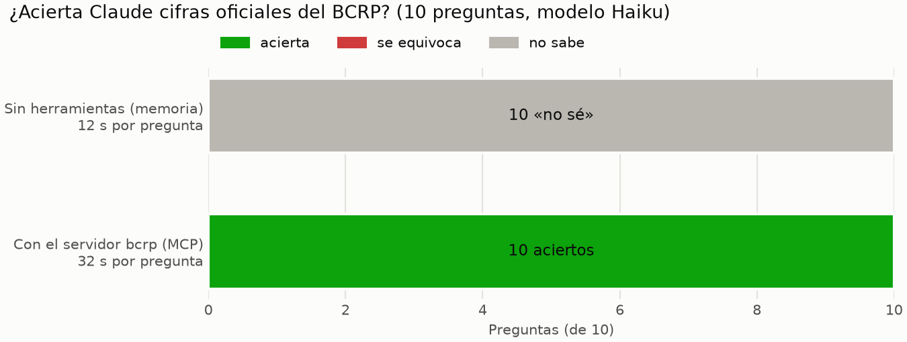

# MCP-BCRP · Las series oficiales del BCRP en Claude

Un servidor MCP, hecho con FastMCP 4, que le da a Claude acceso a las series estadísticas del Banco Central de
Reserva del Perú (BCRP): busca la serie, descarga los datos, hace las cuentas en Python y cita la fuente.
Proyecto de la Diplomatura PUCP 2026, sesión 04: MCP y Claude Code.

**Resultado:** con 10 preguntas sobre cifras oficiales, Claude Haiku acertó **10 de 10 con este servidor** y
respondió «no sé» en las 10 sin él. El detalle de cada pregunta está en [informe.md](informe.md).



## Qué ofrece el servidor

| Tipo | Nombre | Qué hace |
|---|---|---|
| Herramienta | `buscar_series` | Busca el código de una serie por palabras, por ejemplo «ipc 12 meses» |
| Herramienta | `serie` | Los datos de una serie entre dos fechas, con la URL de la fuente |
| Herramienta | `resumen` | Primero, último, cambio, variación %, promedio, máximo y mínimo, calculados en Python |
| Herramienta | `comparar_paises` | El Perú frente a otros países, con datos anuales del Banco Mundial |
| Recurso | `bcrp://serie/{codigo}` | La ficha de una serie |
| Recurso | `bcrp://series/destacadas` | Las fichas de 7 series muy consultadas (inflación, tipo de cambio, tasa de referencia…) |
| Prompt | `informe(tema)` | Un informe que cita el código y el periodo de cada cifra |

## Archivos

| Archivo | Qué es |
|---|---|
| `server.py` | El servidor MCP |
| `test_server.py` | Las 8 pruebas del curso, sin cambios |
| `.mcp.json` | Conecta los servidores `bcrp` y `fetch` a Claude Code, sin claves |
| `preguntas.csv` | Las 10 preguntas de la evaluación, con la cifra oficial y la tolerancia |
| `evaluar.py` | Hace cada pregunta a Claude sin herramientas y con el servidor, y califica |
| `resultados.csv` | Lo que dio `evaluar.py` |
| `grafico.py` · `grafico.png` | La figura del informe |
| `informe.md` | El análisis de los resultados |

## Cómo usarlo

Se necesita [uv](https://docs.astral.sh/uv/), Claude Code con la sesión iniciada e internet.

```bash
uv run pytest -q     # las 8 pruebas: 8 passed
uv run evaluar.py    # repite la medición: 20 llamadas a claude -p con Haiku
uv run grafico.py    # vuelve a generar grafico.png
```

Para usarlo en Claude Code, abran `claude` en esta carpeta y aprueben los servidores de `.mcp.json`. Algunos
ejemplos:

- Una pregunta: *¿Cuál fue la inflación de Lima a 12 meses en setiembre de 2026?*
- Un recurso: `@bcrp:bcrp://series/destacadas`
- El prompt: `/mcp__bcrp__informe inflación`

La primera vez, el servidor descarga el catálogo del BCRP (unos 7 MB) a `datos/`. Esa carpeta no está en el
repositorio porque se vuelve a bajar sola.
